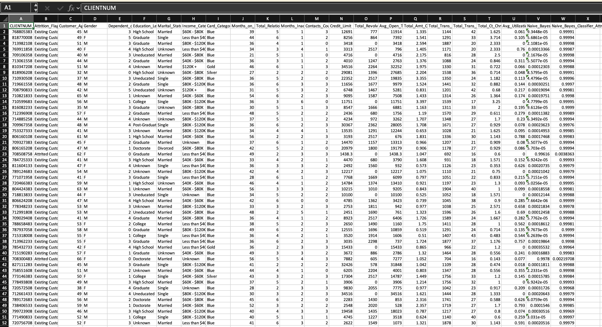
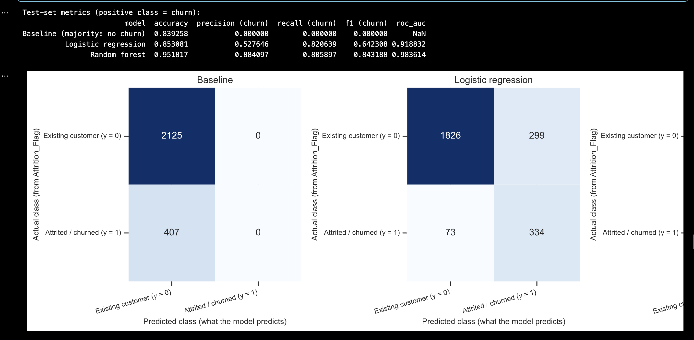

Customer Attrition Data Analysis
1. Project Overview

This project uses Python and Pandas to explore a customer dataset containing 10,127 records and 23 columns. The dataset contains information about customer demographics, account information, credit information, and transaction activity. The main goal of the project was to organize the data, explore customer characteristics, and investigate patterns associated with customer attrition.

The project provided an opportunity to practice working with DataFrames, examining different data types, grouping records, calculating statistics, and creating visualizations to communicate findings.

Here is a screenshot of the dataset

2. Dataset and Tools

The primary tool used for this project was Python with the Pandas library. The dataset includes variables such as customer age, gender, education level, income category, card category, credit limit, total revolving balance, transaction amount, and transaction count.

The DataFrame.info() output showed that the dataset contains 10,127 entries and 23 columns. The columns include integer, floating-point, and object/string data types.

3. Analysis Process

I began by loading the dataset into a Pandas DataFrame and examining its structure. I used methods such as info(), value counts, grouping, and summary statistics to understand the available variables.

I then compared customer characteristics based on the attrition field. This allowed me to investigate whether variables such as transaction activity, credit information, and customer demographics differed between customers who remained with the company and customers who left.

I also created visualizations to make the results easier to interpret.

4. Results and Findings

One of the main goals of the analysis was to identify patterns that could help explain customer attrition. I compared different customer attributes and transaction behaviors between the two attrition groups.

The visualizations helped make differences in the data easier to see than looking only at raw DataFrame output. The analysis also demonstrated how Pandas can be used to transform a large dataset into smaller summaries that are easier to interpret.

5. Model Performance and Evaluation

After exploring the dataset and identifying patterns associated with customer attrition, I developed and evaluated three machine learning models: Baseline, Logistic Regression, and Random Forest.

I used the test dataset to compare the models based on accuracy, precision, recall, F1-score, and ROC-AUC. I also examined confusion matrices to understand how accurately each model predicted customers who churned and those who remained with the company.

The Random Forest model achieved the strongest overall performance, with 95.18% accuracy, 88.41% precision, 80.59% recall, an F1-score of 84.32%, and a ROC-AUC score of 98.36%.

Logistic Regression achieved 85.31% accuracy and slightly higher churn recall at 82.06%, while the baseline model failed to identify customers in the churn class.

The results suggest that Random Forest was the strongest overall model for predicting customer attrition, while Logistic Regression may also be useful when identifying a higher proportion of potential churners is a priority.

Model Evaluation Screenshot

6. Challenges and Debugging

One challenge was understanding the large number of columns in the original dataset. The initial DataFrame information output was lengthy and difficult to interpret because there were many variables.

I addressed this by examining individual columns and grouping related variables together during the analysis. Another challenge was deciding which variables would provide the most useful comparisons for understanding customer behavior.

7. What I Learned

This project improved my experience working with Python DataFrames and real-world-style datasets. I practiced inspecting data, grouping records, calculating statistics, and creating visualizations.

I also learned that data analysis involves more than simply loading a dataset. Choosing meaningful variables, checking the structure of the data, and presenting results clearly are important parts of communicating an analysis.

